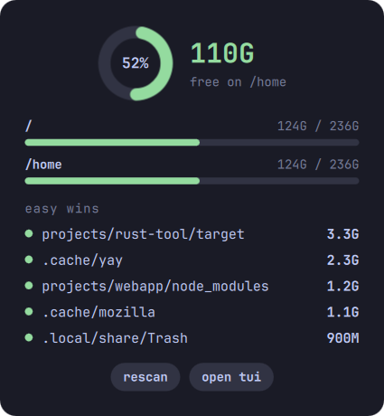

# Storage Viewer

A terminal UI that shows how full your disks are, draws where the space went, and lists the 10 biggest items in your home directory **ordered by how safe they are to delete**. It also ships as a bar plugin for [Omarchy](https://omarchy.org/) and as a standalone [Quickshell](https://quickshell.org/) panel.

<p align="center"></p>

Read-only by design: it never deletes anything, makes no network calls, and runs no subprocesses.

## Features

- Donut charts for the main disk (home / other / free) and for what fills your home directory, plus a usage bar for every mounted filesystem
- Top 10 largest items, most removable first, each tagged and explained
  - **SAFE**: regenerates on its own (caches, trash, build output)
  - **REVIEW**: probably removable, but only you can judge (downloads, VMs, games)
  - **KEEP**: personal data, settings, keys, or source code
- Size by last modified: bytes per age bucket, and a gridded size-versus-age plot where each listed item is a point labelled with its rank, so old and big stands out
- Build output found anywhere under home (`target/`, `node_modules/`, `__pycache__/`, `build/`, `dist/`, virtualenvs) is listed on its own and not double counted
- Colors come from your terminal's own palette, so it follows your theme (on Omarchy that means the active theme)
- Runs on any Linux distro: Python 3.9+ standard library only, nothing to `pip install`
- Optional Omarchy bar plugin and standalone Quickshell panel. The panel is a small card: free space on your home mount, bars for `/` and your home mount, and the top 5 easy wins. The TUI has the full detail.

## Install

```bash
git clone https://github.com/DevInBlack001/storage-viewer.git
cd storage-viewer
./install.sh
```

That installs per user, with no root, into your XDG directories. It adds the `storage-viewer` command, a desktop entry and icon, and, when they are detected, the Omarchy plugin and the Quickshell config.

| Command | What it does |
| --- | --- |
| `./install.sh` | Install (see `--help`: `--system`, `--prefix DIR`, `--no-omarchy`, `--no-quickshell`, `--no-desktop`, `--dry-run`) |
| `./update.sh` | `git pull --ff-only`, then reinstall with the same options |
| `./uninstall.sh` | Remove everything the installer added (`--purge` also removes your config and cached scan) |

Install locations follow `XDG_DATA_HOME`, `XDG_CONFIG_HOME` and `XDG_BIN_HOME`. Uninstall only removes files recorded in the install manifest.

Without cloning, pip works too: `pip install .` provides the `storage-viewer` command.

### Omarchy

The repository root is an Omarchy plugin, so you can also use Omarchy's own installer:

```bash
omarchy plugin add https://github.com/DevInBlack001/storage-viewer.git --enable
```

If you used `./install.sh` instead, enable it with `omarchy plugin enable devinblack001.storage-viewer`. The shell caches plugin code, so run `omarchy-restart-shell` after installing or updating. Click the drive icon in the bar to open the panel.

### Quickshell (non-Omarchy)

```bash
./install.sh --quickshell --no-omarchy
qs -c storage-viewer                                   # shows a small icon; click it
qs -c storage-viewer ipc call storage-viewer toggle    # or bind this to a key
```

Colors come from the Qt system palette. Optional environment variables: `STORAGE_VIEWER_TERMINAL` (command used by "Open TUI", default `xdg-terminal-exec`), `STORAGE_VIEWER_HIDE_ICON=1`, `STORAGE_VIEWER_EDGE=bottom`.

## Usage

```bash
storage-viewer              # interactive TUI
storage-viewer --text       # plain report
storage-viewer --json       # machine-readable, used by the panels
storage-viewer --json --disks-only
storage-viewer --root ~/Projects --top 20
```

TUI keys: `up`/`down` (or `j`/`k`) select, `r` rescans, `q` quits.

```text
 Storage Viewer   /home/user

  DISK                                                           HOME

       ⣀⣤⣶⣶⣶⣶⣶⣶⣤⣀        /  btrfs                                     ⣀⣤⣶⣶⣶⣶⣶⣶⣤⣀        ● Downloads                  8.4G  28%
     ⣠⣾⣿⣿⣿⣿⣿⣿⣿⣿⣿⣿⣷⣄                                                 ⣠⣾⣿⣿⣿⣿⣿⣿⣿⣿⣿⣿⣷⣄      ● VirtualBox VMs             5.9G  19%
    ⣼⣿⣿⣿⠟⠉    ⠉⠻⣿⣿⣿⣧     ● Home                     30G  13%       ⣼⣿⣿⣿⠟⠉    ⠉⠻⣿⣿⣿⣧     ● .local                     4.8G  16%
   ⢸⣿⣿⣿⠃  56%   ⠘⣿⣿⣿⡇    ● Other used              102G  43%      ⢸⣿⣿⣿⠃  30G   ⠘⣿⣿⣿⡇    ● projects                   4.5G  15%
   ⢸⣿⣿⣿   used   ⣿⣿⣿⡇    ● Free                    102G  43%      ⢸⣿⣿⣿ in home  ⣿⣿⣿⡇    ● .cache                     4.0G  13%
   ⢸⣿⣿⣿⡄        ⢠⣿⣿⣿⡇      of 236G                                ⢸⣿⣿⣿⡄        ⢠⣿⣿⣿⡇    ● Videos                     1.5G   5%
    ⢻⣿⣿⣿⣦⣀    ⣀⣴⣿⣿⣿⡟                                               ⢻⣿⣿⣿⣦⣀    ⣀⣴⣿⣿⣿⡟     ● Pictures                   1.2G   4%
     ⠙⢿⣿⣿⣿⣿⣿⣿⣿⣿⣿⣿⡿⠋      /boot  12% of 2.0G                         ⠙⢿⣿⣿⣿⣿⣿⣿⣿⣿⣿⣿⡿⠋      ● (everything else)           80M   0%
       ⠉⠛⠿⠿⠿⠿⠿⠿⠛⠉                                                     ⠉⠛⠿⠿⠿⠿⠿⠿⠛⠉

  SIZE BY LAST MODIFIED                                          ITEMS: SIZE vs AGE  (numbers match the list)

        < 7d  ━━━━━━━━━━━━━━━━━─────────────────   4.5G  15%      8.3G │
     7d - 4w  ━━━━━━━━━━━━━━━━━━━───────────────   5.1G  17%           │                                     5         6
    4w - 3mo  ━━━━━━━━━━━━━━━━━━━━━━━━━━━━━━━━━─   8.8G  29%           │               1     7
  3mo - 12mo  ━━━━━━━━━━━━━━━━━━━━━━━━━━━━━━━━━━   9.2G  30%           │                                 2           9       8
      > 12mo  ━━━━━━━━━━────────────────────────   2.7G   9%      779M │          3         4                              10
                                                                       └────────────────────────────────────────────────────────
                                                                         1d                           4w                    12mo

  TOP ITEMS  most removable first

   1  [ SAFE ]    3.3G  ━━━━━───    5d   ~/projects/rust-tool/target               Rust/Java build output, rebuilt by cargo/maven
   2  [ SAFE ]    2.3G  ━━━─────    5w   ~/.cache/yay                              AUR helper build cache, rebuilt on demand
   3  [ SAFE ]    1.2G  ━━──────    3d   ~/projects/webapp/node_modules            JavaScript dependencies, restored by npm/pnpm…
   4  [ SAFE ]    1.1G  ━───────    9d   ~/.cache/mozilla                          Application cache, rebuilt on demand
   5  [REVIEW]    5.9G  ━━━━━━━━   2mo   ~/VirtualBox VMs/dev-box                  Virtual machine, delete only if you no longer…
   6  [REVIEW]    5.7G  ━━━━━━━━   7mo   ~/Downloads/ubuntu-24.04.iso              Downloaded file, check it before deleting
   7  [REVIEW]    3.9G  ━━━━━───   10d   ~/.local/share/Steam                      Steam games and runtimes (uninstall unused ga…
   8  [REVIEW]    2.1G  ━━━─────  13mo   ~/Downloads/dataset.zip                   Downloaded file, check it before deleting
   9  [REVIEW]    1.5G  ━━──────   5mo   ~/Videos                                  Personal videos
  10  [REVIEW]    1.2G  ━━──────  10mo   ~/Pictures                                Personal pictures

  /home/user/projects/rust-tool/target  -  Rust/Java build output, rebuilt by cargo/maven
  age = newest file inside   SAFE regenerates   REVIEW only you can judge   KEEP personal data or code
  up/down select   r rescan   q quit      read-only: nothing is ever deleted
```

## How an item is ranked

Rules match a path relative to your home directory, one glob per segment, and cover everything beneath it. First match wins; user rules come before the built-in ones. An item nothing matches is **REVIEW**, never SAFE.

Locations are not hardcoded: rules use `$XDG_CACHE_HOME`, `$XDG_DATA_HOME`, `$XDG_CONFIG_HOME` and the user folders (`$XDG_DOWNLOAD_DIR`, `$XDG_VIDEOS_DIR`, ...), resolved from your environment and `user-dirs.dirs`. A relocated cache or a localized `Téléchargements` folder is matched correctly.

## Configuration

Optional. Read from `$STORAGE_VIEWER_CONFIG`, else `$XDG_CONFIG_HOME/storage-viewer/config.json`. See [`config.example.json`](config.example.json).

| Key | Meaning |
| --- | --- |
| `top_n` | Items to list (1 to 50, default 10) |
| `max_seconds`, `max_entries` | Scan limits; a hit is reported as a partial result |
| `min_item_bytes`, `min_artifact_bytes` | Size floors for listed items and build-output folders |
| `warn_percent`, `critical_percent` | Disk usage colors (75 and 90) |
| `cache_max_age` | Seconds a cached scan is reused by `--json` |
| `age_buckets_days` | Boundaries for the last-modified graphs |
| `rules` | `{ "path", "tier", "reason" }` entries, checked before the built-in rules |
| `expand` | Folders that only contain other things, so the list looks inside them |
| `artifacts` | Extra rebuildable folder names, optionally gated by `markers` (sibling files) |

A broken config never stops the tool: it prints a warning and uses the defaults.

## Safety and privacy

- Read-only and local-only. Nothing is deleted, sent, or executed.
- Symlinks are never followed; the scan stays on one filesystem; hard links are counted once.
- Entry, time, depth, and per-directory limits bound memory and run time.
- Unreadable folders are reported as **blocked** (permission denied), separately from missing ones.
- File names are sanitised before display and rendered as plain text in the TUI and the QML panels.
- Config and cache files are opened without following symlinks and are size-bounded.
- The only network access in the project is `git pull` in `update.sh`.

## Development

```bash
python3 -m unittest discover -s tests
omarchy plugin validate .      # on Omarchy
shellcheck -x install.sh update.sh uninstall.sh scripts/common.sh
```

Layout: `storage_viewer/` (scanner, rules, disks, report, TUI, CLI), `Content.qml` / `Donut.qml` / `Backend.qml` / `Model.js` (shared panel UI), `Panel.qml` + `manifest.json` (Omarchy plugin), `quickshell/storage-viewer/shell.qml` (standalone panel).

## License

MIT, see [LICENSE](LICENSE).
